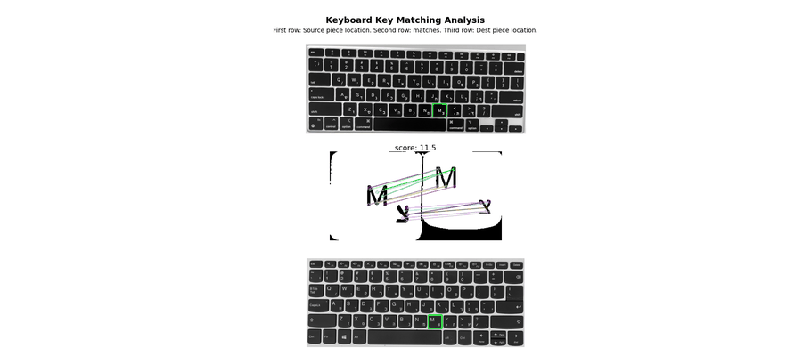
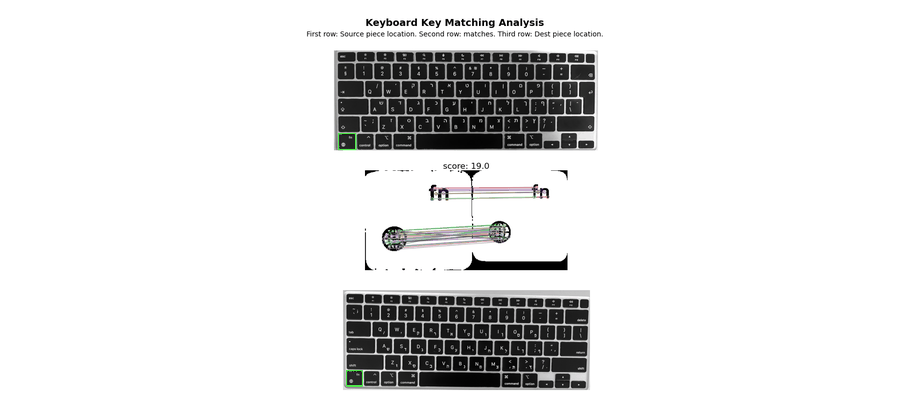

# Keyboard Layout Matching

A Python computer-vision project that finds where pieces of one keyboard belong on a different keyboard layout, using classical feature detection and matching (no deep learning). It supports matching between Mac and Windows keyboards, as well as between Mac keyboard variants whose Hebrew/English key labels are arranged differently.

## Demo

**Mac ↔ Windows**



**Pink Mac ↔ White Mac**

On the pink keyboard (source), English letters are on the bottom of each key and Hebrew letters on top; on the white keyboard (target) the order is reversed. The matcher still pairs the pieces correctly.



## Overview

Given a source keyboard and a target keyboard, the program extracts individual keyboard pieces, describes them with SIFT features and contour geometry, and locates each piece's matching region on the target keyboard. A gap-based scoring system keeps only the strongest, most distinct matches, and the results are visualized with feature correspondences and their location on both keyboards.

## Features

- Image preprocessing with binary thresholding and morphological closing
- Keyboard piece extraction with intelligent edge cropping
- Contour-based feature analysis and nested-contour filtering
- SIFT feature matching with kNN and ratio test
- Gap-based match scoring
- Duplicate-match filtering across pieces
- Detailed visualizations mapping each match to its location on both keyboards
- Multiple layout comparisons:
  - Mac → Windows
  - Mac variants with different Hebrew/English label order (pink → white)

## Requirements

- Python 3.7+
- OpenCV (`opencv-python`)
- NumPy
- Matplotlib
- Pillow (only for generating GIFs)

## Installation

```bash
git clone https://github.com/Adiaharoni55/image-prossesing-keyboards.git
cd image-prossesing-keyboards
pip install opencv-python numpy matplotlib pillow
```

## Usage

1. Place the keyboard images in the `data/` folder:
   - `mac.jpeg` — white Mac keyboard
   - `windows.jpeg` — Windows keyboard
   - `pink_mac.jpg` — pink Mac keyboard (for the Mac-to-Mac comparison)

2. Choose the comparison in the `if __name__ == "__main__":` block of `main.py`. Keep exactly one of these calls uncommented:

```python
# Mac -> Windows (default)
main(mac_binary, windows_binary, windows, mac)

# Pink Mac -> white Mac
# main(pink_mac_binary, mac_binary, mac, pink_mac, max_gap_thresh=1.0)
```

3. Run:

```bash
python main.py
```

### Saving the results as a GIF

Pass `gif_path` to `main` to also save the results as an animated GIF, with one frame per matched piece (requires Pillow):

```python
main(mac_binary, windows_binary, windows, mac, gif_path="images/keyboard_matches_win_vs_mac.gif")
```

The GIF is created by `create_matches_gif()` in `create_gif.py`, which reuses the same figure layout as the on-screen visualization.

## Project Structure

```
├── main.py          # Matching pipeline and visualization
├── create_gif.py    # Saves the match visualizations as an animated GIF
├── data/            # Input keyboard images
└── images/          # Demo GIFs used in this README
```

## How It Works

1. **Image preprocessing**
   - Converts images to binary with per-keyboard thresholds
   - Applies morphological closing (3×3 kernel, two iterations) to the Mac keyboard images to reduce noise
   - Crops piece edges to remove border artifacts

2. **Contour processing**
   - Detects keyboard pieces with OpenCV's `findContours`, discarding small contours
   - Removes nested contours to avoid duplicates
   - Sorts contours by area (largest first) and computes each one's center, width and height

3. **Feature matching**
   - Detects scale- and rotation-invariant SIFT keypoints and descriptors
   - Performs kNN matching with a ratio test
   - Matches contours one-to-one: each source contour can match only one target contour

4. **Match selection**
   - Scores each candidate as matched features per contour; candidates need a score of at least 1.0
   - Keeps the top 3 distinct scores within a gap threshold, up to 5 matches per piece
   - Uses different gap thresholds for different keyboard pairs
   - Once a target piece is a source piece's only remaining match with a score above 4.5, it is locked so later pieces can't reuse it

5. **Visualization** (`visualize_matches_detailed`)
   - **Source row:** marks the matched location on the source keyboard with a green frame
   - **Feature row:** shows SIFT correspondences between the source piece (left) and the matched target piece (right) using `drawMatches`, with each match's score
   - **Target row:** marks the matched location on the target keyboard with a green frame
   - Multiple matches are laid out automatically in a grid

## Key Functions

| Function | Purpose |
|---|---|
| `find_contours()` | Contour detection with filtering |
| `crop_edges()` | Crops piece edges to remove border noise |
| `filter_contained_contours()` | Removes nested contours |
| `match_contours()` | Matches contours between pieces using SIFT features |
| `find_matching_pieces()` | Core matching algorithm with score-based selection |
| `reduce_matches()` | Removes duplicate matches |
| `draw_match_figure()` | Builds the three-row figure for one source piece |
| `visualize_matches_detailed()` | Shows the match visualizations on screen |
| `create_matches_gif()` | Saves the visualizations as an animated GIF (`create_gif.py`) |

## Parameters

| Category | Parameter | Value |
|---|---|---|
| Binary threshold | Mac keyboard | 135 |
| | Windows keyboard | 170 |
| | Pink Mac keyboard | 100 |
| Morphology | Closing kernel / iterations (Mac images) | 3×3 / 2 |
| Contour filtering | Minimum piece area | 100 px |
| | Inner-contour border margin | 10 px |
| Matching | SIFT ratio test | 0.875 |
| | Minimum candidate score | 1.0 |
| | Score gap threshold | 2.5 (Mac–Windows), 1.0 (Mac–Mac) |
| | Max matches per piece | 5 |
| | Max distinct scores | 3 |
| | Target-piece lock score | 4.5 |

## Known Limitations

- Requires consistent lighting across input images
- Sensitive to differences in keyboard orientation
- Gap thresholds may need tuning for new keyboard pairs
- Processing time grows with image resolution

## Libraries Used

- [OpenCV](https://opencv.org/) — image processing and SIFT
- [NumPy](https://numpy.org/) — numerical computation
- [Matplotlib](https://matplotlib.org/) — visualization
